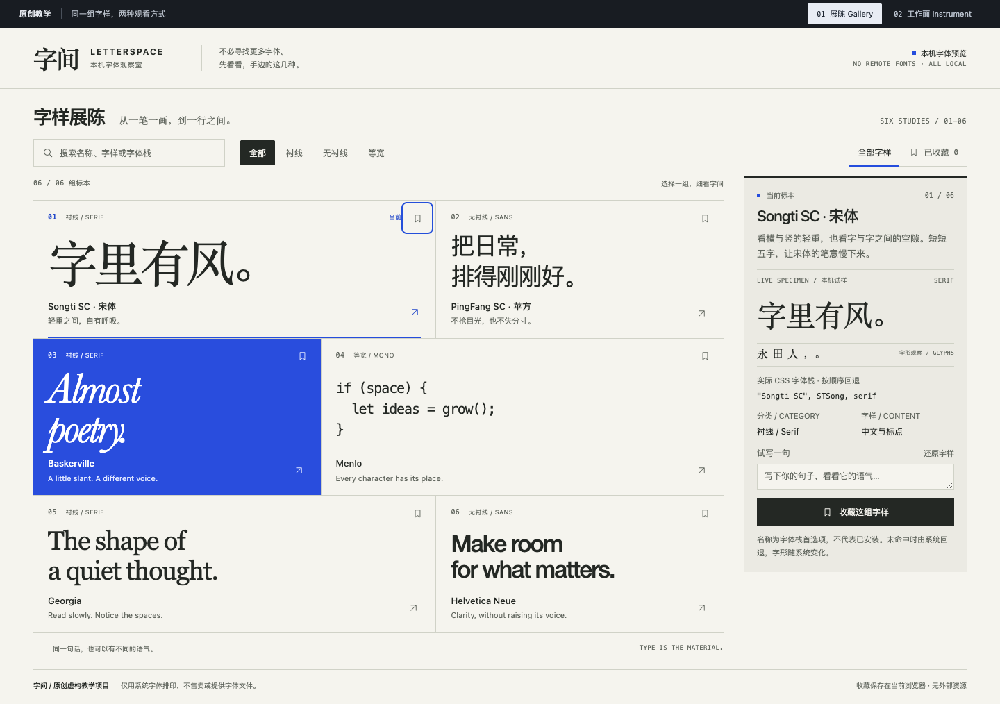

# UI Taste Skill

[English](README.en.md) · 简体中文

让 AI 编程助手把界面改版做成可检查的过程：先比较两个视觉方向，再用设计卡约束实现，最后在最密的一屏和窄屏上验收。

[安装](#安装) · [试一个任务](#试一个任务) · [看示范](#看示范)

[](assets/reference-evidence/studio-gallery-desktop.png)

「字间」教学示范：展陈方向用字号与疏密组织六份字体标本；同样内容的[工作面方向](assets/reference-evidence/studio-instrument-desktop.png)压紧目录、放大当前标本，把重心从浏览移到检查。

## 改版流程

- **从真实内容出发，比较两条方向**：用最终语言、最长标题和最复杂的对象试排；差别落在构图、材料或对象表达上，不是换一套配色。可以由你选稿，也可以授权助手自行取舍并做完。
- **把方向写成设计卡**：区域比例、目标视口、标题断行、素材裁切和关键状态逐条写清；实现时按它检查，防止默认值把关系磨平。
- **保留原稿与范围**：给了参考图就保留它的构图与排印关系；局部精修不扩大为全站改版，也不强凑两个方向。
- **先做最难的一屏**：密集内页、展开态和窄窗先验证，再推广；独立读图评审与匿名对照把审美判断和功能通过分开。

适用于网页、桌面软件、移动 App 与 Web 工作台的新设计、改版和评审。

## 安装

这是供编程助手读取的指令与参考资料包，不是独立设计软件。README 有中英两版，**技能指令与参考资料目前为中文**。

安装前查看 [SKILL.md](SKILL.md)、`references/` 及附带脚本，了解会执行什么代码、访问哪些外部服务；导入完整包，不要只放入口文件。已有同名技能时先核对来源，备份需要保留的修改。

三个客户端共用一条 `skills` CLI 命令，装的是同一个完整技能包；需要 **Node.js 22.20+** 和已安装的客户端。在终端任意目录运行：

```sh
npx skills add DreamOfXM/ui-taste-skill -g
```

按提示选择客户端，或用 `-a` 指定。`-g` 是用户级安装，所有项目可用；在目标项目目录去掉 `-g` 则只装到该项目。

- **Claude Code**（`-a claude-code`）：`~/.claude/skills/`；新会话输入 `/` 选择 `ui-taste-skill`
- **Codex**（`-a codex`）：`~/.agents/skills/`；新会话输入 `$ui-taste-skill`
- **Qoder Desktop**（`-a qoder`）：`~/.qoder/skills/`；新任务输入 `/` 选择 `ui-taste-skill`

装好后开启新会话，确认技能出现在可选列表里。没有出现时，检查包内是否包含 `SKILL.md` 和 `references/`、安装目录是否与上面一致，再重启客户端。没有 Node.js 22.20+ 时无法运行这条命令：Qoder Desktop 可导入[发布附件 ZIP](https://github.com/DreamOfXM/ui-taste-skill/releases/latest/download/ui-taste-skill.zip)（发布附件可能落后于仓库最新提交）；其他客户端需要先安装 Node.js 22.20+。

维护：`npx skills update ui-taste-skill -g` 更新，`npx skills remove ui-taste-skill -g` 卸载；装到多个客户端时会提示选择目标，也可加 `-a`。Cursor、Gemini CLI、OpenCode 等其他受支持的客户端走同一条命令，目标名见[支持列表](https://github.com/vercel-labs/skills/blob/main/docs/agents.md)；安装器支持某个客户端，不等于本技能已在该客户端验证。

## 试一个任务

在已有项目中选中技能，提供要修改的页面或截图，然后输入：

```text
请使用 ui-taste-skill 改版当前页面，
保留已有功能。
先用真实内容比较两个视觉方向，
等我确认后再写设计卡并落实到代码。
完成后运行页面并读图，
分别检查功能、视觉和窄屏状态。
```

第一次应得到两个可比较的方向，而不是立即收到整页实现。确认后，设计卡应明确布局、字体、关键状态和响应式处理；交付时应附上实际运行与读图的检查结果。

按参考图还原时，附图并说明要保留哪些关系；局部精修时指明范围；只想评审就加上“先不要修改代码”。

## 看示范

示范是仓库内的离线 HTML 页面，不是托管站点。取得完整仓库或解压 ZIP 后，需要 Python 3；在仓库根目录或解压后的技能根目录运行：

```sh
python3 -m http.server 8788 --bind 127.0.0.1
```

服务运行时在浏览器打开 `http://127.0.0.1:8788/`，进入下列路径（相对仓库根目录）；结束后在终端按 `Ctrl+C` 停止，服务停止后这些页面就打不开。

- `assets/variant-board.html`：同一组标本的展陈与工作面构图，可切换、筛选与试写。
- `assets/reference-workbench.html`：列表与详情、搜索、收藏及窄屏返回。
- `assets/reference-editorial.html`：中文排印、阅读节奏、文章与主题筛选。
- `assets/app-craft-lab.html`：比较同内容的排布，检查列表、详情与偏好。
- `examples/project-radar/index.html`：真实项目的改版原型，让项目用途先于统计信息被看见。

前四个是内容虚构的教学页面。项目雷达使用 2026-10-19 的公开数据快照，只覆盖浏览、筛选与详情，不是线上产品。页面使用本地字体，外观可能随系统变化。设计关系见[视觉拆解](references/visual-examples.md)。

## 使用边界与参考

Skill 提供设计与验证方法，不保证每个模型都能稳定产出优秀界面，也不替代产品决策、功能实现与安全审查。仓库示范都是网页，原生 App 仍需在目标平台验收；执行环境无法读图时，视觉与交互结论需要补验。

参考资料（中文）：

- [完整技能指令](SKILL.md)
- [生成方法](references/generation.md)
- [参考适配](references/visual-calibration.md)
- [排印与中英混排](references/typography.md)
- [独立看图评审](references/review.md)
- [网页取证工具](references/tooling.md#通用网页取证)与[匿名对照](references/evaluation.md#执行可复查的匿名对照)

<details>
<summary>维护者：运行验证</summary>

在仓库根目录运行包检查，需要 Python 3.9+，仅使用标准库：

```sh
python3 -B -m unittest discover -s tests -v
```

检查覆盖安装切换、恢复、元数据、资源链接、截图哈希及匿名对照工具。取证工具的浏览器用例还需本机 Node.js 与 Chrome / Chromium，缺失时会跳过并报告；使用隔离的临时目录，不操作真实安装目录，也不评价审美。

重新生成示范的浏览器证据需要 Node.js 18+ 与 Chrome / Chromium：

```sh
node scripts/verify-app-craft.cjs
node scripts/verify-references.cjs
```

找不到浏览器时通过 `CHROME_BIN` 指定。脚本使用隔离的临时浏览器配置，会更新仓库内的报告和截图；更新后仍需实际读图。范围与方法见[效果验证](references/evaluation.md)。

</details>

## 许可

作者：DreamOfXM。采用 [MIT 许可证](LICENSE)，允许商业或非商业使用、修改和再分发，需保留版权与许可声明。
