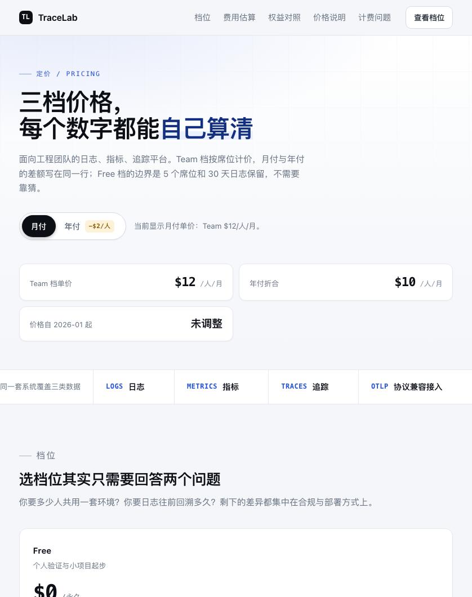
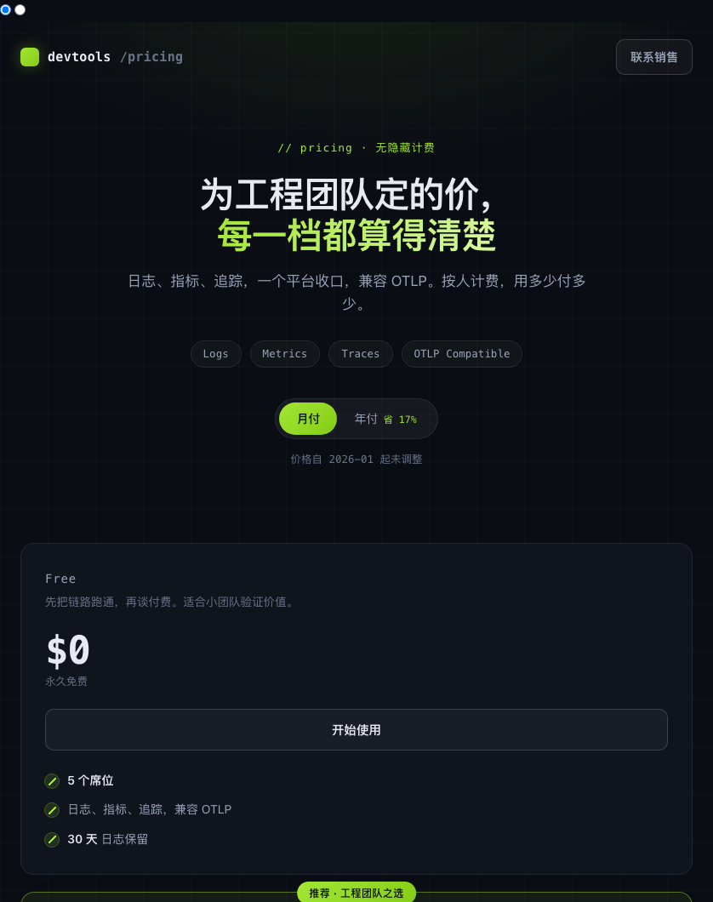
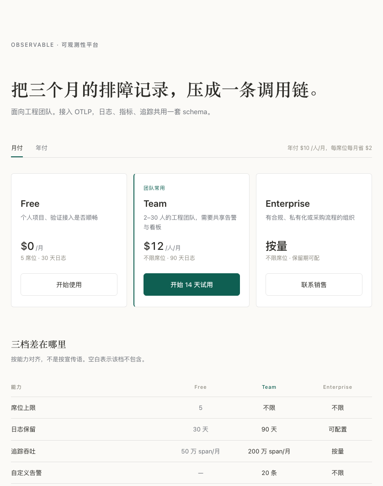
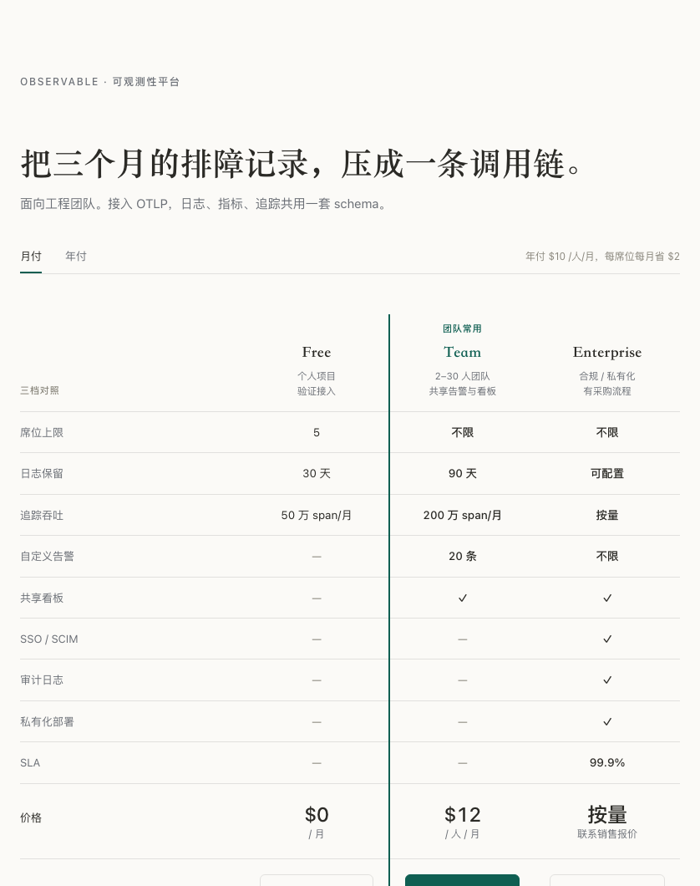

# ui-taste-skill

   

让 AI 编程助手把界面设计做成**有出处、可比较**的过程：先排内容优先级（全页只留一个 P0），再按品类列出 5–6 套互不相同的方向，最后交付 5–6 版都合规、彼此看得出差别的关键屏，和一份写明「换来什么、放弃什么」的取值账本。

## 安装

技能正文与指令目前只有中文。需要 Node.js 22.20+ 和已装好的客户端。

### Claude Code

```sh
npx skills add DreamOfXM/ui-taste-skill -g -a claude-code
```

新会话输入 `/`，技能列表里出现 `ui-taste-skill` 即装好。

### Codex

```sh
npx skills add DreamOfXM/ui-taste-skill -g -a codex
```

新会话输入 `$ui-taste-skill`。

### Qoder

```sh
npx skills add DreamOfXM/ui-taste-skill -g -a qoder
```

新任务输入 `/`，技能列表里出现 `ui-taste-skill`。

卸载：

```sh
npx skills remove DreamOfXM/ui-taste-skill -g
```

没有 Node.js 时下载[发布附件 ZIP](https://github.com/DreamOfXM/ui-taste-skill/releases/latest/download/ui-taste-skill.zip)（停在 `v3.2.0`，落后主分支，只作离线兜底）：解压出的整个目录就是技能包，`references/` 等子目录不能丢。

## 用法

选中技能，给出页面、受众和必须保留的事实：

```text
用 ui-taste-skill 重做这个定价页：三档，中间档推荐，给工程团队评估。
保留现有文案与价格事实，缺的信息标 [待补]，不要编。
```

第一次应拿到 **5–6 套方向清单**——每套写清借了哪个已存在的类型、**那个类型自带的规矩是什么**、**破例清单**（破在哪 / 破了哪条规矩 / 为什么该破，可以多处，理由必须指向页面上的具体内容或文案）、底面/按钮/字体/密度四个具体值、各自换来什么放弃什么——而不是一个整页。规则要求任意两套之间**构图、材料、对象表达三轴里有两轴不同**：只有配色不同的算同一套，去色并排看不出差别的不算交付。你可以现在挑一套、只反对其中一维，也可以说「都画出来我再挑」（默认走这条）。回答写进 `design/00-direction.md`，交付时按它验收。

## 示例

`example/pricing-page/` 是一次完整实跑，brief 是虚构的 DevTools 定价任务（三档、中间档推荐、给工程团队评估）。下面三组图回答两个问题：**同一份输入能不能拿到可预期的取值**，以及**加了约束之后画面有没有更好看**。

**可预期性。** 同一份冻结输入（brief 原话加事实清单，不含任何设计指导），不加载本技能，两次独立生成，同一视口截图。





两跑连底色都相反，且没有一处取值能回答「为什么是这个值」。

**画面能量。** 这一组是改出来的，不是天生如此。旧规则下加载本技能的两稿，强调只剩一个彩色按钮、首屏标题 38px，当时的用户评价是「基线那一组比 skill 这一组好看」。根因不在执行，在验收函数：第 1/4/5 问全是破坏式测试（去阴影、数档数、换灰），它们的共同最优解就是手段最少、材质最平的那一版。补上 S5 第十一问——强调级落点 ≥3 处且分布在 ≥2 个顶层区块、字号跨度 ≥2.6、材质 ≥2 类且各有职责——之后重跑同一份输入：


三稿打乱成甲/乙/丙交给两个拿不到生成方式和设计理由的评审者，两次用了不同的打乱顺序，排名一致：**新规则稿 > 基线一 > 基线二**。实测数字（`python3 scripts/probe-energy.py`，838×1060）：

| 稿 | 强调级落点 / 区块 | 其中文字着色 | 跨度 | 材质 | 匿名排名 |
|---|---|---|---|---|---|
| 基线一 | 6 / 2 | 6 | 3.72 | 5 类 | 2 |
| 基线二 | 2 / 1 | 2 | 3.68 | 2 类 | 3 |
| 新规则稿 | 9 / 3 | 2 | 5.00 | 3 类 | 1 |

只有**两次**独立对照，不证明技能从此稳定；第十一问的数字每次交付都要现测。这稿的五件产物齐（冻结输入、方向、账本、`pass-c.html`、十一问自评，见 `example/rerun-0.3.1/`），自评里的能量数字是技能自带 `probe-energy.py` 的实测输出；但跑的那一轮**没有独立读图执行者**，「值得看」只有数字支撑，上表的排名来自我另外做的两次匿名并排。两位评审也独立点到同一处弱点：新规则稿的 Free 卡与 Team 卡挂着同一枚虚线「未逐项列出」胶囊，看着像没做完的占位（全页共 18 处这类虚线占位，自评里记为「不编造内容」的有意保留，但首屏 3 处仍读作未完成）——这一处仍是要改的，不是评审噪声。

**结构轴。** 旧规则那两稿还说明另一件事：加载本技能后共用同一份账本取值（底色、强调色、字号阶、圆角档数一致），只在结构上取值相反。





差异全部落在「档位卡和对照表谁在前」这一根轴上，两稿各自的取舍记在 [02-ledger.md](example/pricing-page/02-ledger.md)。这两稿的 HTML 已不在本机，只有截图，所以不参与上面那张按新门槛重测的表。逐项对账见 [04-diff.md](example/pricing-page/04-diff.md)：那里「裸默认」一列是推测值，与实测的色值和档数不完全一致，以实测为准。本地打开 [compare.html](example/pricing-page/render/compare.html) 可切换三版，打开 [before-after.html](example/pricing-page/render/before-after.html) 可把上面五张图按「不加载技能 / 旧规则 / 改后规则」分组并排看。

## 流程

| 阶段 | 干什么 | 落盘 |
|---|---|---|
| S1 读约束 | 七个字段、判品类 C1–C9、采样产品界面底色 | `00-brief.md` |
| S1.5 内容优先级 | 排 P0/P1/P2/P3，全页一个 P0，点数首屏元素 | `01-content.md` |
| G0 方向确认门 | 甲案 = 品类默认家族，再加 4–5 套互不相同的方向 | `00-direction.md` |
| S2 立论 | 主张、三条承诺、一条放弃（全版本共用） | `01-thesis.md` |
| S3 记账 | 六列：决定 / 取值 / 依据 / 换来 / 放弃；跨版取值按版本分列 | `02-ledger.md` |
| S4 成稿 | 5–6 版关键屏：首屏 + 本产品最难那一屏，同内容同视口 | `v1.html` … `v6.html`、`compare.html` |
| S5 验收 | **三层逐版各跑一遍**：① 地板 = 十一问 + 状态矩阵；② 整体感 = 回读门（独立实例盲看三问）；③ 优劣 = 同视口匿名并排二选一。不过的改到过，不删版 | `03-critique.md` |

S1.5 排在 G0 之前：没排位次就问方向，组合卡只能比颜色，你只能凭顺眼挑。**每一步的产物是下一步的唯一合法输入**——页面不对，先看 S5 哪一问不过，那一问指向哪个阶段，那个阶段的产物里必有一行是错的；一次性生成只能整页重写，且说不清哪里错。

一次实跑读 19 个文件、约 3,200 行，各阶段读哪些写在 [SKILL.md](SKILL.md) 的加载表里。

## 边界

- **保证下限，不保证上限。** 十一问、状态矩阵、账本都是**地板**：全过只证明「这页没塌」，不证明「好看」。第十问管大小、第十一问管能量（强调落点、字号跨度、材质类数），它们把「往下限收敛」变成有数字的门槛，但**数字拦得住「平」，拦不出「好」**——阈值标定自一份定价页、一个视口的三稿（n=3），不是通用美感阈值，换品类换视口要现测。整体感由**回读门**取证：换一个没看过账本与主张的独立实例盲看画面，回答「这页自己的规矩是什么 / 哪几处不合这规矩 / 每处为什么该破」，原话照录，读不出就是不过。它同样只判失败，判不了优秀；优秀靠同视口并排二选一，结论归你。不承诺任何模型必然产出好看界面。
- **破例可以多处，判据不是数量。** 高级感 = 页面自己立的规矩站得住 + 破规矩的地方破得有理由。规矩指**成稿画面**，不是账本；破例一处也行五处也行，但**每一处的理由必须能只看画面就说出来**——指向具体内容或文案（「这个数字是全页唯一的结论」）合格，「为了有层次」不合格。需要设计者开口解释才成立的破例，就是失败的破例。
- **不自动判分。** 十一问和矩阵是清单不是脚本；唯一例外是第十一问的落点 / 跨度 / 材质可由 `scripts/probe-energy.py` 实测，但它量不出「为什么是它」那一半。**回读门更不可能脚本化**——它要一个没继承你理由的独立实例真看画面，产出是原话记录不是分数；没有独立执行者时只能自看并标明「非独立」，那不构成整体感结论。G0 是自然语言契约，没有 schema 校验，模型伪造一份「用户确认」机制识别不了；P0 是否真的「不可能被编造」也只能人眼复核。
- **它会问你。** 开放设计动笔前必须过 G0。无人值守时按「写明假设继续」执行，并把补上的假设单列在交付里。
- **它不替你排序。** 地板只回答「这一版有没有塌」，回读门只回答「这一版有没有自己的道理」，都不回答「哪版最好」。5–6 版全部合规之后，谁胜出由你看着画面选；数字最高的那版未必是你想要的（实跑里出现过强调落点 16 处全是 1px 描边的版本，门过了，画面比不过门的另一版平）。
- **不做组件库。** 只生成这一页需要的，不产出通用 Button / Card。
- **上下文预算不低。** 上面那 19 个文件一次实跑都要读，客户端上下文吃紧时先算这笔账；预算不够时的正确做法是 6 版收到 5 版，不是跳过探针或回读门。
- **取证脚本要本机 Chrome。** 六个 `scripts/probe*` 里四个用 headless Chrome 读 DOM 拿实测值（R2 级）：能量门槛 `probe-energy.py`、首屏结构 `probe-structure.py`、图片是否真的加载 `probe-assets.py`、命令与长 URL 是否溢出 `probe-overflow.py`。找不到浏览器就退回人工测量并如实标明；两个 `.mjs` 需要 Node，四个 `.py` 只需 python3 标准库，都无 npm 依赖。
- **面向网页。** 交付物是 HTML/CSS。原生 App 与 macOS/iOS 控件工艺在 0.3.x 没有对应模块，需在目标平台另行验收。
- `skills` 安装器支持某个客户端，不等于本技能已在该客户端验证过。
- **与另外两类 design skill 的分工**：约束类管下限防丑，货架类管选项广度，这个管取舍与方向归属——回答「这些约束下你为什么这么选、付了什么」，并在动笔前把选择权还给你。

## 参考

- [SKILL.md](SKILL.md) — 入口：分流、十四条硬纪律、高级感三层验收、六阶段 + G0、加载表、各类准入与验收契约
- `references/` — 12 份阶段方法：brief 七字段、内容位次、方向门、方向清单与关键屏、参考准入、主张、账本、地板、状态矩阵、评审、**回读门**、视觉来源
- `registers/` — 9 份：品类原型 C1–C9、六套表面配方、六套排印配方、六份调性
- `patterns/` — 5 份页面骨架：定价、营销首屏、仪表、设置表单、表格列表
- `tokens/scale.md` — 所选配方内部的间距 / 字号 / 圆角 / 行高格子，不规定全站底色
- `scripts/` — 六个 DOM 实测器：参考页取证 `probe.mjs`、品类统计 `probe-surface.mjs`、第十一问能量 `probe-energy.py`、第十问首屏结构 `probe-structure.py`、图片真实加载 `probe-assets.py`、命令与 URL 溢出 `probe-overflow.py`（后四者只要 python3 标准库 + 本机 Chrome，不需要 Node）
- `example/`、`assets/` — [pricing-page/](example/pricing-page/) 是一次完整实跑，[rerun-0.3.1/](example/rerun-0.3.1/) 是补上第十一问之后同一份输入的产物（`frozen-input.md` + 方向与位次文档 + `pass-c.html`），另有语法课本、参考实拍，以及上面五张截图的源 HTML

正文共 28 个文件、3,633 行，每份另配同名 `.html` 逐行镜像供浏览器阅读，agent 加载 `.md`。借鉴边界见 [SOURCE.md](SOURCE.md)，许可 [LICENSE](LICENSE)（MIT）。
