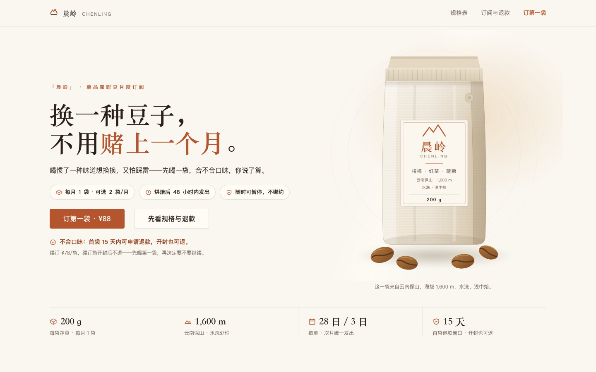
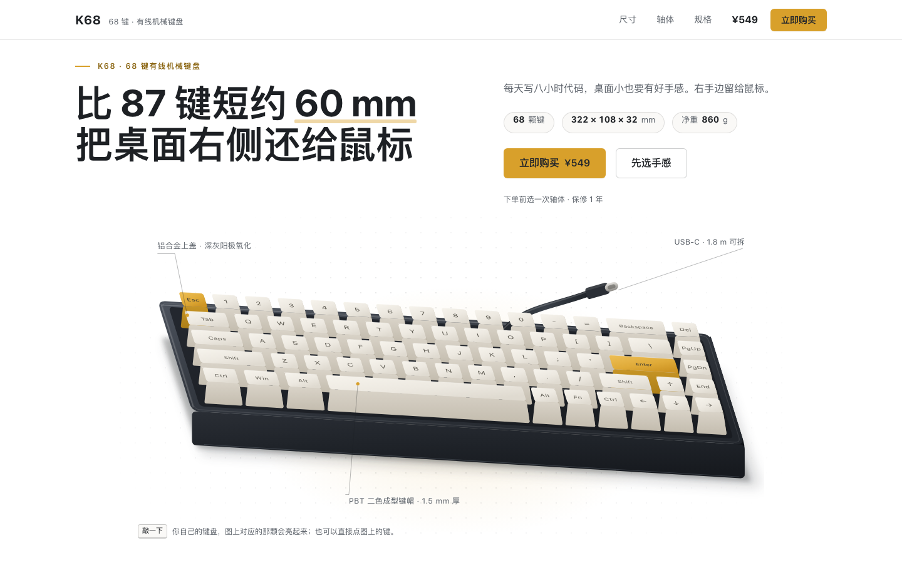
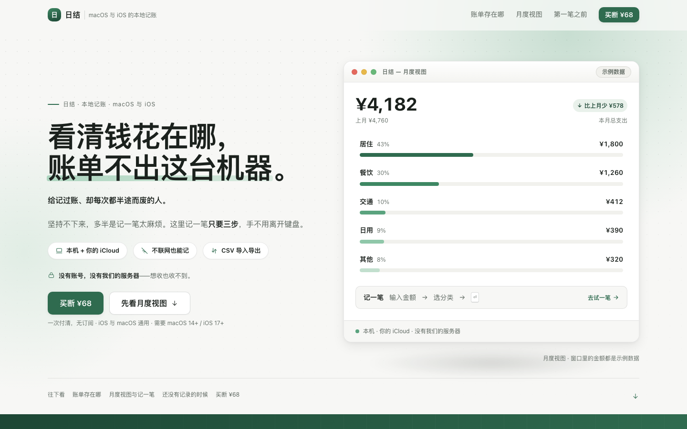
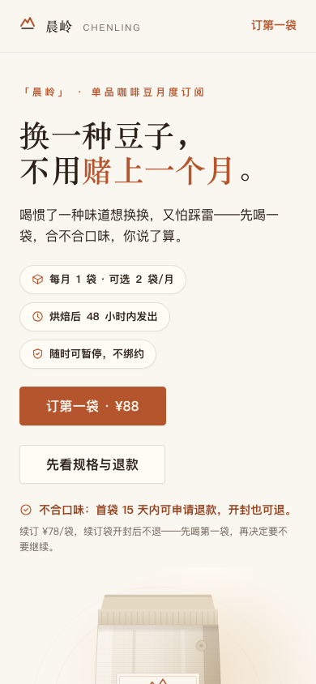
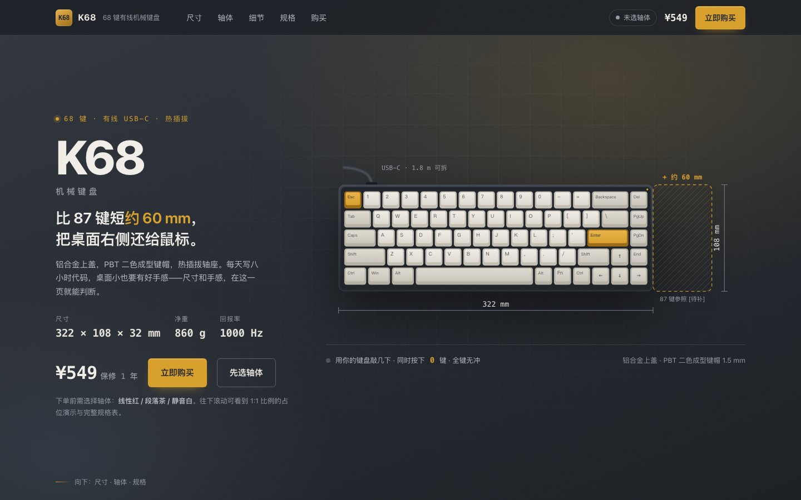

# ui-taste-skill

  

让 AI 编程助手把一屏当成一件完整作品：先想清界面给谁、他要判断什么，用一套统一的间距/字号/文案底子把整屏做连贯，再精修。管保底（不残、不丑、内容真实、节奏统一），靠范例与并排对照提高上限的概率，不承诺保证产出好 UI。



练习任务：虚构咖啡豆订阅页，加载技能的最终版（用户认可）。[更多效果图](#效果) · [安装](#安装) · [用法](#用法) · [边界](#边界)

## 效果

三份完整练习 brief，产品均为虚构：咖啡豆订阅「晨岭」、机械键盘 K68、本地记账「日结」。每份 brief 各出「加载技能」与「不加载技能」两版，同视口截图、匿名打乱并排，按用户反馈多轮修订。下面都是加载技能版的最终形态，均经用户认可（首屏那张咖啡图是其中之一）：





移动端不是事后补的。同一份咖啡页在真 390px 下：



**对照怎么做的。** 以键盘题为例，下面两张是同一份 brief：第一张不加载技能，第二张加载技能。不加载版并不弱——有的轮次用户判它更好，加载版是借了它的关系修出来的。技能的作用是保底 + 提高上限的概率，不是每轮必赢；哪版更好由你并排挑，不由技能自评。




## 安装

安装器需要 Node.js 22.20+；技能正文本身不跑 Node。指令与正文目前只有中文，触发描述中英双语。

### Claude Code

```sh
npx skills add DreamOfXM/ui-taste-skill -g -a claude-code
```

新会话输入 `/`，技能列表里出现 `ui-taste-skill` 即装好。

### Codex

```sh
npx skills add DreamOfXM/ui-taste-skill -g -a codex
```

新会话输入 `$ui-taste-skill`。

### Qoder

```sh
npx skills add DreamOfXM/ui-taste-skill -g -a qoder
```

新任务输入 `/`，技能列表里出现 `ui-taste-skill`。

卸载：

```sh
npx skills remove DreamOfXM/ui-taste-skill -g
```

没有 Node.js 时下载[发布附件 ZIP](https://github.com/DreamOfXM/ui-taste-skill/releases/latest/download/ui-taste-skill.zip)（停在 `v3.2.0`，落后主分支，只作离线兜底）：解压出的整个目录就是技能包，`references/` 等子目录不能丢。

## 用法

选中技能，给出页面、受众和必须保留的事实：

```text
用 ui-taste-skill 重做这个定价页：三档，中间档推荐，给工程团队评估。
保留现有文案与价格事实，缺的信息标 [待补]，不要编。
```

第一次拿到什么，取决于任务：

- **开放新设计 / 整体重做**：5–6 版明显不同的关键屏（构图/材料/对象表达至少两轴不同，只有配色不同算同一版），挑定再展开整页。
- **给了原稿或已认可方向**：原稿即规格，单稿忠实深化。
- **局部精修**：只改受影响处，不借机翻新整页。

## 包里有什么

- [SKILL.md](SKILL.md) — 入口：七条正面原则、统一底子、短清单兜底、任务分流与加载表。
- `tokens/scale.md` — 间距 / 字号 / 字重 / 圆角 / 阴影 / 动效刻度，全页共用一套。
- `references/taste-gallery.md` — 两张用户亲手选中的首屏；动笔前看图，借一条主关系。
- `registers/` — 品类原型 C1–C9、六套排印配方、六套材质配方；判品类取默认，一页内部不混搭。
- `patterns/` — 5 份页面骨架：定价、营销首屏、仪表、设置表单、表格列表。
- `references/` — 选读深查：文案表述、工艺地板、视觉来源等。
- `scripts/` — 可选 DOM 探针（对比度 / 溢出 / 结构 / 能量），默认不跑。

品类原型与骨架是反复验证过的积累，**不覆盖所有品类**；没覆盖的从内容推导，不硬套。每份 `.md` 另配同名 `.html` 镜像供浏览器阅读，agent 加载 `.md`。

## 边界

- **保证下限，不保证上限。** 清单全过只证明「没塌」；好不好由你同视口匿名并排挑。不承诺任何模型必然产出好看界面。
- **面向网页。** 交付物是 HTML/CSS；原生 App 与 macOS/iOS 控件工艺没有对应模块，需在目标平台另行验收。
- **探针可选。** 四个 `.py` 只要 python3 标准库 + 本机 Chrome，两个 `.mjs` 需要 Node；不跑就人工测量并如实标明。
- **安装器支持某客户端 ≠ 已在该客户端验证。** Qoder、Claude Code、Codex 都读 SKILL.md 头部的 description 触发；`_meta.json` 触发词只对 Qoder 有效。
- **不做组件库。** 只生成这一页需要的，不产出通用 Button / Card。

## 参考

- [SOURCE.md](SOURCE.md) — 借鉴边界；[LICENSE](LICENSE) — MIT。
- `example/` — 早期实跑存档（旧流程：方向门 / 账本 / 十一问），截图只作历史对照，不要照那份流程做。
